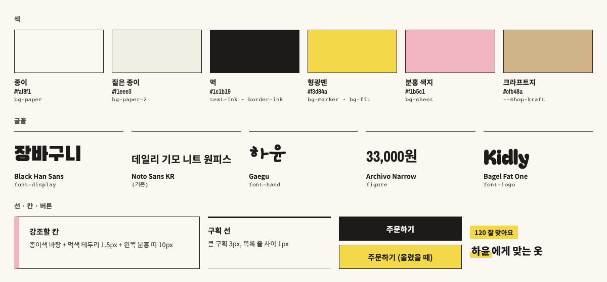
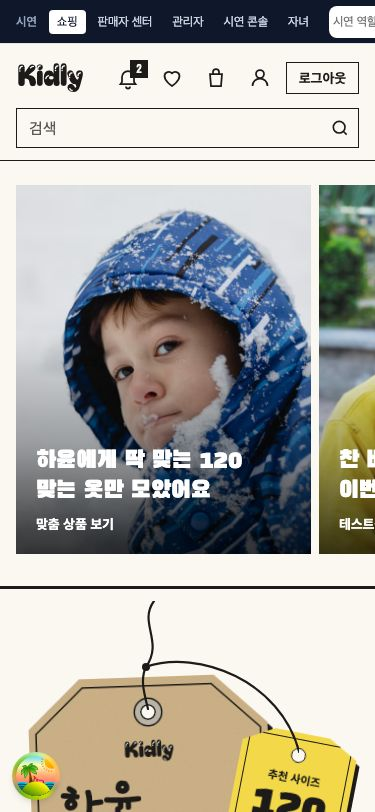
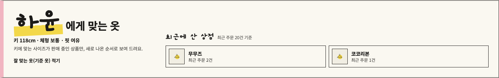
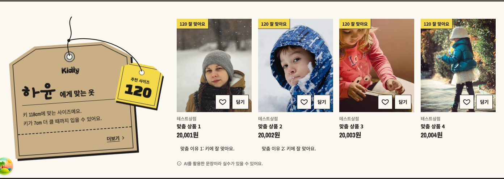

# 디자인 시스템 (쇼핑 영역)

쇼핑 영역(보호자 · 자녀 화면)을 고치거나 새 화면을 만들 때 지키는 약속이다. 값은 모두 코드에 있고, 이 문서는 어디에 무엇이 있는지와 왜 그렇게 쓰는지를 적는다. 값이 문서와 코드에서 다르면 코드(`src/shop.css`)가 맞다.

판매자 센터 · 관리자 · 시연 콘솔은 이 문서의 대상이 아니다(1절).

## 1. 영역마다 기준이 다르다

| 영역                              | 표시                 | 기준                                                                                     |
| --------------------------------- | -------------------- | ---------------------------------------------------------------------------------------- |
| 쇼핑 · 자녀                       | `data-area="shop"`   | 이 문서. 종이 · 먹 · 분홍 색지 · 형광펜 네 색, 각진 모서리                               |
| 판매자 센터                       | `data-area="center"` | shadcn 기본 부품 + `src/index.css` · `src/center.css`의 색. 새 디자인 작업을 하지 않는다 |
| 관리자                            | `data-area="admin"`  | 위와 같다 (`src/admin.css`)                                                              |
| 시연 콘솔 · 시연 막대 · 흐름 패널 | 없음                 | `src/index.css`의 기본 색                                                                |

- 영역은 레이아웃(`src/app/layouts`)이 맨 바깥 요소에 `data-area`를 달아 정한다. 화면 파일에서 `data-area`를 직접 달지 않는다.
- 쇼핑 색은 `[data-area='shop']` 안에서만 다시 정한다. **`:root` 값은 고치지 않는다.** 판매자 센터와 관리자가 같은 변수를 쓰기 때문이다.
- 같은 화면이 쇼핑과 콘솔에 함께 연결되는 경우가 있다(자녀 · 배송지 · 예치금 등). 이런 화면은 변수와 Tailwind 색 이름만 쓰면 영역에 따라 모양이 저절로 바뀐다. 색 값을 직접 쓰면 콘솔에서 깨진다.
- 쇼핑 영역을 고친 뒤에는 판매자 센터 · 관리자 · 콘솔의 색과 글자가 바뀌지 않았는지 화면으로 확인한다.

## 2. 원칙

1. **상품 사진이 주인공이다.** 바탕은 종이색 하나고, 색 면으로 구획을 나누지 않는다. 구획은 먹색 선으로 나눈다.
2. **색은 뜻이 있을 때만 쓴다.** 형광펜은 「맞다」와 올렸을 때, 분홍은 아이와 관련된 작은 표시에만 쓴다.
3. **모서리는 각지다.** 종이를 자른 느낌을 낸다. 둥근 것은 3.3절의 예외뿐이다.
4. **그림자 대신 테두리를 쓴다.** 뜨는 창 · 버튼 · 카드 모두 먹색 실선으로 구분한다.
5. **백엔드에 있는 값만 그린다.** 리뷰 수 · 순위 · 할인율처럼 응답에 없는 값을 꾸며 넣지 않는다.
6. **사용자 화면에 백엔드 용어를 쓰지 않는다.** 이벤트 이름 · 상태 코드는 콘솔과 흐름 패널에서만 보여 준다.

## 3. 기본 값



### 3.1 색

| 이름         | 값                     | Tailwind                             | 쓰는 곳                                                                |
| ------------ | ---------------------- | ------------------------------------ | ---------------------------------------------------------------------- |
| 종이         | `#faf8f1`              | `bg-paper`                           | 바탕 전체                                                              |
| 짙은 종이    | `#f1eee3`              | `bg-paper-2`                         | 사진 자리, 종이 위에서 한 단계 구분할 칸                               |
| 더 짙은 종이 | 먹 12%                 | `bg-paper-3`                         | 자리만 잡아 두는 칸(더 있는 개수 표시 등)                              |
| 먹           | `#1c1b19`              | `text-ink` · `border-ink` · `bg-ink` | 글, 테두리, 주요 버튼                                                  |
| 옅은 먹      | 먹 84%                 | `text-ink-2`                         | 설명 글                                                                |
| 더 옅은 먹   | 먹 68%                 | `text-ink-3`                         | 덧붙이는 글(상점 이름, 개수, 기준)                                     |
| 가는 선      | 먹 25%                 | `border-rule`                        | 목록 줄 사이, 탭 줄                                                    |
| 형광펜       | `#f3d84a`              | `bg-marker` · `bg-fit`               | 「맞다」(추천 사이즈 · 「120 잘 맞아요」), 버튼을 올렸을 때, 이름 밑줄 |
| 분홍 색지    | `#f1b5c1`              | `bg-sheet` · `border-l-sheet`        | 칸의 왼쪽 띠, 머리글자 동그라미 같은 작은 표시                         |
| 크라프트지   | `#cfb48a`              | `var(--shop-kraft)`                  | 홈 맞춤 구획의 옷 태그에만                                             |
| 오류         | shadcn `--destructive` | `text-destructive`                   | 오류 문구. 네 색에 빨강이 없어 기존 빨강을 그대로 쓴다                 |

- `text-signal` · `bg-signal`은 쇼핑 영역에서 먹색이다(판매자 센터 · 관리자에서는 자두색). 「행동 · 선택」이라는 뜻으로 쓰면 영역마다 맞는 색이 들어간다.
- shadcn 변수(`--primary` · `--border` · `--muted` 등)도 쇼핑 영역에서 같은 네 색을 가리킨다. shadcn 부품은 고치지 않아도 색이 맞는다.
- **분홍을 넓은 바탕으로 쓰지 않는다.** 분홍 위의 글은 잘 읽히지 않는다. 강조할 칸은 4.2절의 모양을 쓴다.
- 종이 위 먹색 글의 대비는 충분하다. 형광펜 · 분홍 위에는 먹색 글만 올린다(흰 글 금지).

### 3.2 글꼴

`index.html`의 Google Fonts 링크 하나로 불러온다. 글꼴을 더할 때도 이 링크에 더한다(패키지를 설치하지 않는다).

| 글꼴           | Tailwind                                      | 쓰는 곳                                                        | 주의                                                    |
| -------------- | --------------------------------------------- | -------------------------------------------------------------- | ------------------------------------------------------- |
| Noto Sans KR   | (기본)                                        | 본문, 버튼, 상품 이름                                          | 굵기 400 · 500 · 700 · 800                              |
| Black Han Sans | `font-display` · `text-page` · `text-section` | 화면 제목, 구획 제목, 큰 숫자                                  | 굵기가 하나뿐이다. `font-bold`를 같이 쓰지 않는다       |
| Bagel Fat One  | `font-logo`                                   | 로고                                                           | 로고는 `KidlyLogo` 부품을 쓴다. 글자로 다시 쓰지 않는다 |
| Gaegu          | `font-hand`                                   | 아이 이름, 아이가 쓴 조르기 한마디, 손으로 적은 듯한 짧은 제목 | 700만 불러온다. 본문 · 긴 문장에 쓰지 않는다            |
| Archivo Narrow | `figure` · `font-label`                       | 가격, 수량, 치수                                               | `figure`는 숫자 폭도 맞춘다                             |

글자 크기

| 이름                             | 크기                       | 쓰는 곳                               |
| -------------------------------- | -------------------------- | ------------------------------------- |
| `text-page`                      | 28 ~ 48px (화면 폭에 따라) | 화면 제목. `PageHeader`가 알아서 쓴다 |
| `text-section`                   | 22 ~ 30px                  | 구획 제목                             |
| `text-lg` (18px)                 |                            | 상품 칸의 가격                        |
| `text-[15px]` · `text-sm` (14px) |                            | 본문, 탭, 상품 이름                   |
| `text-[13px]` · `text-xs` (12px) |                            | 덧붙이는 글                           |

- 가격 · 수량 · 치수에는 늘 `figure`를 단다.
- 한글은 낱말 단위로 줄이 바뀌고, 문단 끝에 낱말 하나만 남지 않게 되어 있다(`shop.css`). 화면에서 `<br>`로 줄을 억지로 나누지 않는다.

### 3.3 모서리 · 선 · 그림자

- 쇼핑 영역의 곡률은 모두 0이다. `rounded-md` · `rounded-lg`를 써도 0이 된다.
- 알약 · 동그라미 모양은 `rounded-full` 대신 **`rounded-pill`** 을 쓴다. 쇼핑 영역에서는 각지고, 같은 부품을 쓰는 판매자 센터 · 콘솔에서는 둥글다.
- 정말 둥글어야 하는 곳만 `rounded-full`을 쓴다: 홈 배너의 양옆 넘기기 버튼, 옷 태그의 구멍, 불러오는 중 표시, 안내 아이콘(ⓘ).
- 선 굵기: 칸 · 버튼 · 입력 칸은 `border-[1.5px] border-ink`, 화면 제목 아래와 큰 구획의 위아래는 `border-[3px]`, 목록 줄 사이는 `border-rule` 1px.
- 그림자(`shadow-*`)를 쓰지 않는다. 뜨는 창과 확인 창도 먹색 테두리다. 예외는 종이가 떠 있는 것처럼 보여야 하는 옷 태그의 `drop-shadow` 하나다.

### 3.4 폭 · 간격 · 화면 구간

- 본문 폭은 `max-w-shop`(1440px)이다. 머리말 · 본문 · 바닥글이 같은 폭을 쓴다. 레이아웃이 잡아 주므로 화면 파일에서 다시 정하지 않는다.
- 좌우 여백은 휴대폰 16px(`px-4`), `md`부터 24px(`md:px-6`)이다.
- 화면 구간은 둘만 주로 쓴다: `md`(768px, 휴대폰과 그 밖을 가른다) · `lg`(1024px, 좌우 두 칸 배치를 켠다).
- 구획 사이는 `space-y-6` ~ `space-y-10`, 칸 안쪽은 휴대폰 `px-4 py-6` · 넓으면 `md:p-7`을 기본으로 한다.
- 상품 격자: 휴대폰 2칸, `sm` 3칸, 넓으면 4칸(맞춤 목록) 또는 5칸(홈 전체 상품, 한 쪽 20개). 상품 사진 비율은 4:5다.



그림 속 상품 사진은 시연용 샘플 사진이고, 상품 이름과 가격은 테스트 값이다.

### 3.5 누를 수 있는 것의 크기

- 누르는 것은 높이 44px 이상(`min-h-11`)이다. 글자 링크처럼 작아 보여야 하면 `min-h-10`(40px)까지 둔다.
- 주요 버튼(`.shop-btn`, 담기 · 주문하기)은 48px다.
- 키보드로 옮겼을 때의 테두리(먹색 2px)는 `shop.css`가 넣는다. `outline-none`으로 지우지 않는다.

### 3.6 움직임

- 움직임은 거의 두지 않는다. 넣는 것은 홈 배너 넘기기, 버튼의 색 바뀜(220ms)과 눌림(120ms)뿐이다.
- 들어올 때 떠오르는 효과, 카드마다 올렸을 때 커지는 효과를 넣지 않는다.
- 움직임을 줄이도록 설정한 사용자에게는 바뀜 효과를 끈다(`prefers-reduced-motion`).

## 4. 자주 쓰는 모양

### 4.1 화면의 뼈대

```tsx
<div className="shop-look space-y-6">
  <PageHeader title="장바구니" />
  {/* 구획들 */}
</div>
```

- 쇼핑 화면의 맨 바깥 요소에 `shop-look`을 단다.
- 화면 제목은 `PageHeader`를 쓴다. 쇼핑 영역에서는 큰 제목 아래 굵은 먹색 줄이 붙는다.

### 4.2 강조할 칸

```tsx
<section className="border-ink bg-paper border-l-sheet border-[1.5px] border-l-[10px] px-4 py-6 md:p-7">
```

종이색 바탕 + 먹색 테두리 + 왼쪽 분홍 띠다. 추천 사이즈, 장바구니 요약, 결제 요약, 조르기 결정처럼 눈에 띄어야 하는 칸에 쓴다. 분홍 바탕 칸 대신 이 모양을 쓴다.



### 4.3 형광펜 밑줄

```tsx
<span className="bg-[linear-gradient(transparent_60%,var(--shop-marker)_60%)]">하윤</span>
```

이름이나 숫자 하나를 짚을 때 쓴다. 한 화면에 한두 곳만 쓴다.

### 4.4 상품 칸



- 목록의 상품은 `ProductTile`을 쓴다: 사진(4:5) → 상점 이름(옅게) → 상품 이름(굵게, 두 줄까지) → 가격(`figure`).
- 사진 왼쪽 위 꼬리표는 `tag`로 넘긴다(「120 잘 맞아요」는 형광펜).
- 찜과 담기는 `action` 슬롯으로 넘기고 사진 오른쪽 아래에 놓인다. 순서는 찜, 담기다.
- 가격의 「~」는 옵션마다 가격이 다른 상품에만 붙인다(`hasPriceRange`).

### 4.5 사진이 없을 때

- 상품 사진은 `ProductImage` · `ProductGallery`로 그린다. ``를 직접 쓰지 않는다.
- 사진이 없으면 그 상품 카테고리의 낙서 아이콘을 `doodle`로 넘긴다(`categoryIconOf(이름)`). 카테고리를 모르면 옷걸이(`ALL_CATEGORIES_ICON`)다.
- 판매 중지 상품은 사진 위에 「판매 중지」 도장을 찍는다(`ProductTile`이 그린다).

## 5. 부품

새로 만들기 전에 아래에 있는지 먼저 본다.

| 부품                                              | 위치                       | 쓰는 곳                                            |
| ------------------------------------------------- | -------------------------- | -------------------------------------------------- |
| `Button` · `Badge` · `Card` · `Input` · `Label`   | `shared/ui` (shadcn)       | 기본 부품. 파일을 고치지 않는다                    |
| `PageHeader`                                      | `shared/ui`                | 화면 제목                                          |
| `ModalSheet`                                      | `shared/ui`                | 겹쳐 뜨는 창. 넓으면 가운데 창, 휴대폰은 아래 시트 |
| `ConfirmHost` · `Toaster`                         | `shared/ui`                | 확인 창, 알림 띠. 레이아웃이 이미 깔아 둔다        |
| `StateMessage`                                    | `shared/ui`                | 빈 목록 · 오류 문구 한 줄                          |
| `Skeleton` · `CardGridSkeleton` · `ListSkeleton`  | `shared/ui`                | 불러오는 중                                        |
| `Pagination`                                      | `shared/ui`                | 페이지 번호                                        |
| `KidlyLogo`                                       | `shared/ui`                | 로고. 크기는 높이(`h-8` 등)로 정한다               |
| `ProductTile` · `ProductImage` · `ProductGallery` | `entities/product`         | 상품 칸, 사진                                      |
| `CategoryIcon`                                    | `entities/product`         | 카테고리 낙서 아이콘                               |
| `OptionChipPicker`                                | `entities/product`         | 옵션 고르기. 색은 `colorLook`으로 크기를 고른다    |
| `ChildFitTitle`                                   | `entities/child`           | 「○○에게 맞는 옷」 제목                            |
| `SizeRulerBar`                                    | `entities/child`           | 키와 사이즈 눈금자                                 |
| `FavoriteButton`                                  | `features/toggle-favorite` | 찜                                                 |
| `QuickAdd`                                        | `widgets/quick-add`        | 담기 버튼 + 옵션을 고르는 팝업                     |

색 고르기의 세 크기(`colorLook`)

| 값       | 휴대폰         | 넓은 화면      | 쓰는 곳   |
| -------- | -------------- | -------------- | --------- |
| `detail` | 견본이 붙은 칩 | 큰 견본 타일   | 상품 상세 |
| `quick`  | 견본만         | 견본이 붙은 칩 | 담기 팝업 |
| `chip`   | 칩             | 칩             | 기본      |

- 고른 표시(견본 안 체크 + 바깥 먹색 테두리)와 품절 표시(흐리게 + 사선)는 세 크기가 같다.
- 견본만 쓰는 자리는 고른 색 이름이 바로 위 라벨에 보여야 한다.

### 공용 부품의 모양을 쇼핑 영역에서만 바꾸는 방법

공용 부품 파일을 고치면 판매자 센터 · 관리자 · 콘솔까지 바뀐다. 부품에 `data-slot`을 달고 `shop.css`에서 쇼핑 영역일 때만 바꾼다.

```css
[data-area='shop'] [data-slot='confirm'] {
  border: 1.5px solid var(--ink);
  box-shadow: none;
}
```

지금 이렇게 바꾼 것: `button` · `badge` · `card` · `page-header` · `confirm` · `toast-mark` · `gallery-arrow` · `wish-message`.

## 6. 상태

| 상태        | 그리는 방법                                                                                                                  |
| ----------- | ---------------------------------------------------------------------------------------------------------------------------- |
| 불러오는 중 | `CardGridSkeleton`(상품 격자) · `ListSkeleton`(목록). 빙글 도는 표시를 화면 한가운데 두지 않는다                             |
| 비었을 때   | `StateMessage`로 한 줄. 무엇이 없는지 말한다(「맞는 사이즈가 판매 중인 상품이 없어요.」)                                     |
| 오류        | `<StateMessage tone="error">`에 `getErrorMessage(error)`를 넣는다. 서버가 준 설명을 그대로 보여 주고 문구를 새로 짓지 않는다 |
| 요청 중     | 버튼을 `disabled`로 막고 글을 바꾼다(「불러오는 중…」)                                                                       |
| 끈 것       | 흐리게(`opacity`) + 누를 수 없게. 품절 옵션은 사선도 긋는다                                                                  |
| 고른 것     | 먹색 바탕에 종이색 글, 또는 먹색 테두리                                                                                      |
| 올렸을 때   | 버튼은 형광펜 바탕 + 먹색 글, 글자 링크는 밑줄                                                                               |

- 돈이 움직이는 일(주문하기 · 구매확정 · 충전)은 확인 창을 띄우고 요청 중에는 버튼을 막는다.
- 재고는 5개 이하일 때만 수량을 보여 주고(「재고 3개」), 0이면 「품절」이다.

## 7. 글

- 사용자에게 하는 말은 `~해요` · `~예요`로 쓴다. 「판매 중지」 · 「품절」 같은 상태 이름은 명사로 끝낸다.
- 버튼은 누르면 일어나는 일을 그대로 적는다(「담기」 · 「주문하기」 · 「더 보기」).
- 옵션 이름과 추천 안내 문구는 서버가 준 것을 그대로 쓴다.
- 숫자 범위의 물결표는 앞뒤를 띄운다(`105 ~ 115cm`).

## 8. 하지 않는 것

- `:root` 변수를 고치거나 색 값(`#f1b5c1`)을 화면 파일에 직접 쓰기
- shadcn이 만든 파일(`button.tsx` 등)을 고치기
- 분홍을 넓은 바탕으로 쓰기, 형광펜 · 분홍 위에 흰 글 올리기
- `rounded-full` · `shadow-*`를 3.3절의 예외 밖에서 쓰기
- 응답에 없는 값(리뷰 수 · 순위 · 배너 문구)을 꾸며 넣기
- `ui` 파일에서 API를 부르거나 업무 규칙을 조건식으로 두기 (구조 규칙은 `AGENTS.md` 2절)

## 9. 바꾼 뒤 확인

1. 휴대폰 폭(375px)과 넓은 화면(1440px) 두 곳에서 본다. 가로로 넘치는 것, 잘리는 글이 없는지 본다.
2. 판매자 센터 · 관리자 · 콘솔의 같은 부품이 바뀌지 않았는지 본다.
3. 키보드만으로 옮겨 다니며 테두리가 보이는지 본다.
4. `npm run check`와 `npm run test:e2e`를 돌린다. E2E가 보는 표시(`data-swatch`, `role`, 문구)를 바꿨으면 같은 커밋에서 E2E를 고친다.

## 10. 아직 정해지지 않은 것

- 오류를 보여 줄 색. 지금은 shadcn의 빨강을 그대로 쓴다.
- 로그인, 충전 흐름, 알림함, 자녀 상세는 색 · 글꼴 · 모서리까지 반영했고, 시안과 나란히 놓고 배치를 하나씩 맞춰 보지는 않았다. 이 화면들의 배치를 바꿀지는 정해지지 않았다.
